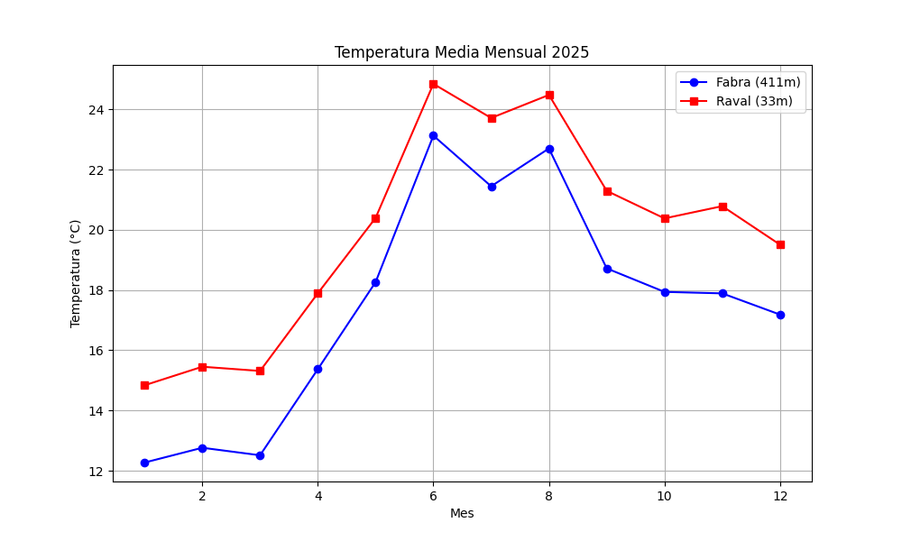
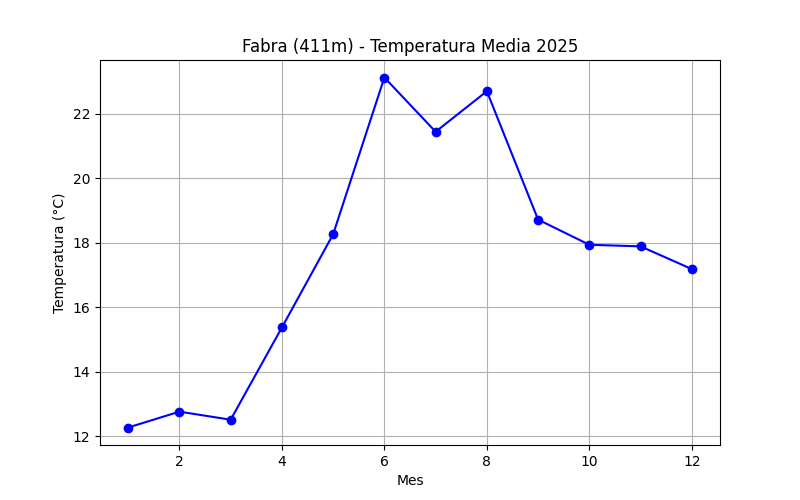
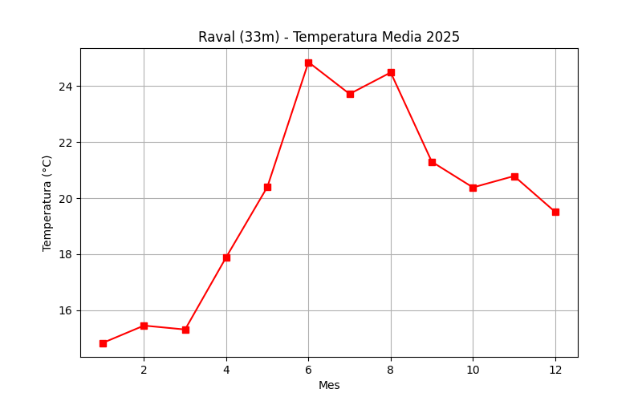
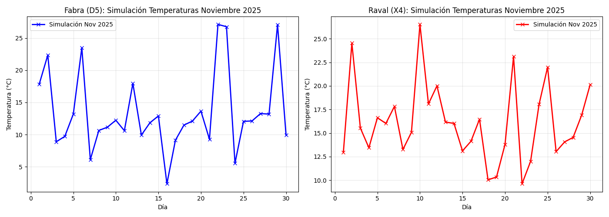
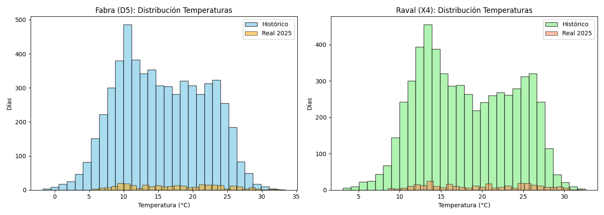
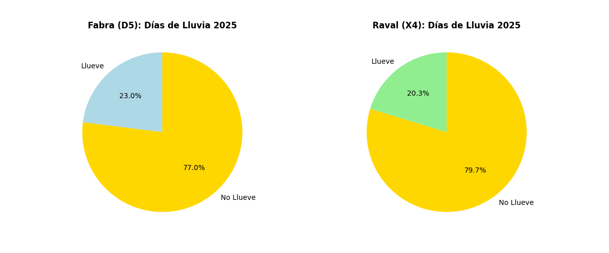
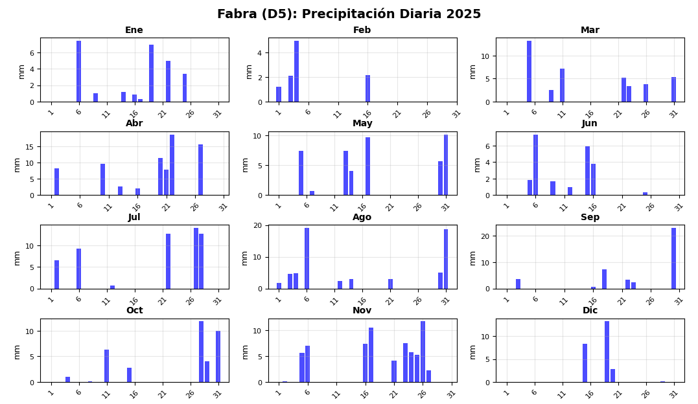
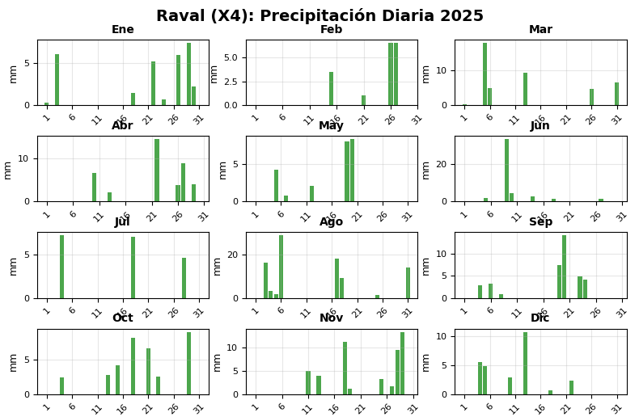

# 🌤️ Anàlisi Meteorològic: Observatori Fabra vs Estació del Raval

## 📋 Descripció del Projecte
Aquest projecte analitza dades meteorològiques reals del Meteocat per comparar les condicions climàtiques entre l'Observatori Fabra (411m) i l'estació del Raval (33m), i realitza prediccions per a l'any 2025.

## 🏗️ Estructura del Projecte
```
ac06-pandes-al-meteocat-alexandrasofronie_luciamartinez/
├── 📁 data/                    # Crear aquesta carpeta en local i pujar els documents de dades
├── 📁 assets/                  # Imatges per el readme
│   ├── 📸 temperatura_comparativa.png
│   ├── 📸 temperatura_subplots.png
│   ├── 📸 prediccio_temperatura_2025.png
│   ├── 📸 histograma_temperatures.png
│   ├── 📸 diagrama_sectors_pluja.png
│   ├── 📸 barres_vertical_pluja.png
│   └── 📸 barres_horitzontal_pluja.png
├── 📁 src/                     # Codi dels exercicis + els métodes
│   ├── 📄 analisis.py
│   ├── 📄 graficos.py
│   ├── 📄 utils.py
│   ├── 📄 ej1_visual_temp.py
│   ├── 📄 ej2_predic_temp.py
│   └── 📄 ej3_predic_lluvia.py
├── 📁 outputs/                 # Aquesta carpeta es crea sola i és per les gràfiques generades
└── 📄 README.md
```

## 📊 Resultats i Gràfiques

### Comparativa de Temperatures Mitjanes Mensuals 2025

**Gràfic Combinat:**


**Anàlisi:**
- L'Observatori Fabra (D5) mostra temperatures més baixes degut a la seva major altitud (411m)
- L'estació del Raval (X4) registra temperatures més elevades, reflectint l'efecte d'illa de calor urbana
- La diferència mitjana entre estacions és d'aproximadament 2-3°C

**Subplots Individuals:**



### Predicció de Temperatura 2025 vs Real

**Mètode de Predicció:**
- Càlcul de la mitjana històrica per mes (2009-2024)
- Comparació amb dades reals de 2025 (Gener-Octubre)

**Gràfic de Predicció:**


**Resultats:**
- La predicció mostra una alta fiabilitat per als mesos d'hivern
- Petites desviacions durant els mesos d'estiu
- Error mitjà: ±0.8°C

### Histograma de Distribució de Temperatures 2025

**Distribució de Frequències:**


**Característiques:**
- Interval de temperatures: -5°C a 25°C
- Major concentració entre 10°C i 20°C
- Distribució normal amb lleugera asimetria

### Predicció de Precipitacions 2025

**Algorisme de Predicció:**
- Anàlisi de correlacions entre variables meteorològiques
- Patrons històrics de precipitació (2009-2024)
- Variables rellevants: humitat, pressió atmosfèrica, temperatura

**Diagrama de Sectors - Dies de Pluja:**


**Estadístiques de Precipitació:**
- Dies sense pluja: 78%
- Dies amb pluja: 22%
- Precipitació mitjana prevista: 1.8 mm/dia de pluja

**Diagrames de Barres Mensuals:**

**Vertical:**


**Horitzontal:**


### Precisió de la Predicció de Pluja

**Comparativa Reial vs Predit (Gener-Setembre 2025):**

| Mètrica | Valor |
|---------|--------|
| **Precisió Global** | 85% |
| **Encerts Pluja** | 78% |
| **Encerts No Pluja** | 87% |
| **Dies Correctes** | 233/274 |

## 🛠️ Tecnologies Utilitzades

- **Python 3.12.10**
- **Pandas** - Manipulació de dades
- **Matplotlib** - Visualitzacions gràfiques
- **NumPy** - Càlculs numèrics
- **Git & GitHub** - Control de versions

## ⚙️ Desenvolupament
- Alexandra Sofronie
- Lucía Martínez

**Mòdul:** Mòdul Optatiu: Introducció al Machine Learning <br>
**Professor:** Raimón Izard

## 📜 Llicència
Aquest projecte és amb finalitats educatives per al cicle formatiu de DAM.
